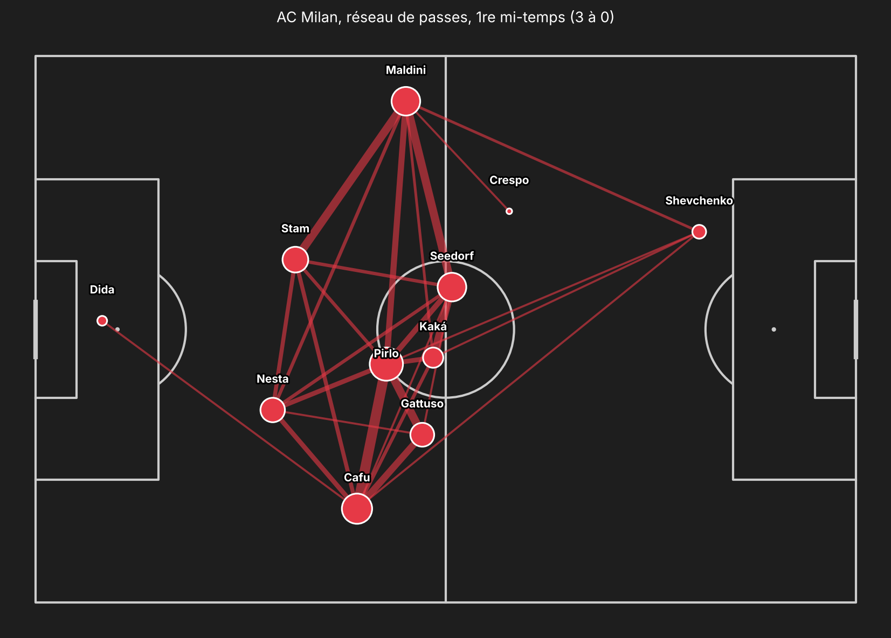
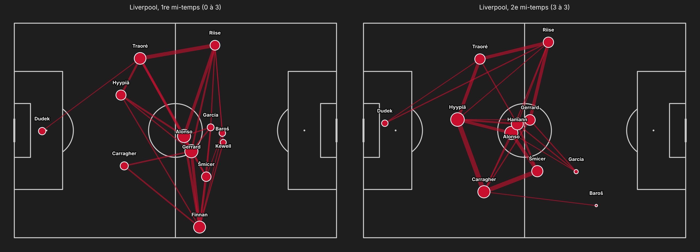
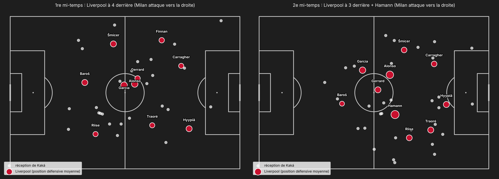
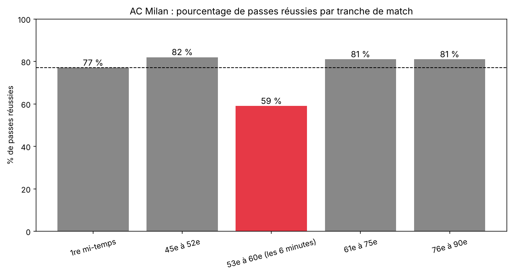

# Istanbul 2005: how Milan lost a 3-0 lead in 6 minutes

**AC Milan 3-3 Liverpool**, UEFA Champions League final, 25 May 2005 (Liverpool won on penalties).

A full match report built from **StatsBomb event data** (4,648 on-ball actions: passes, carries, pressures, shots, each with its pitch location), answering four questions:

1. How did Milan dominate the first half?
2. Why did Liverpool collapse?
3. Why did Milan collapse after the break?
4. How did Liverpool come back?

> The report and the notebook are written in French.



## Key findings

| | |
|---|---|
| **Same possession, different danger** | First half: 256 passes for Milan, 250 for Liverpool, but 1.30 xG against 0.23. |
| **The Pirlo, Kaká, Crespo circuit** | Two goals scored 18 and 9 seconds after winning the ball back, both from a Kaká through ball. |
| **Kaká left free** | 26 balls received in the first half, only 3 under pressure. |
| **Benítez's half-time switch** | Back three, Hamann next to Alonso: Kaká goes from 4 through balls to 0. |
| **Milan switch off** | 53rd to 60th minute: 27 passes, 59% completion, lowest pressing of the match, 3 goals conceded. |
| **Liverpool's efficiency** | The first two goals came from 0.10 xG combined. |







## Contents

| File | Description |
|---|---|
| `rapport_milan_liverpool_2005.ipynb` | Full report: data, reusable functions, the four parts with their conclusions, overall summary |
| `istanbul_2005_carrousel.pdf` | 9-slide visual summary |
| `images/` | All charts produced by the notebook |

## Reusable functions

The notebook is built around four functions that work on any StatsBomb match by changing the match ID:

* `reseau_passes`: pass network for one team and one period
* `dessiner_but`: draws the actions leading to a goal
* `bloc_defensif`: average defensive position of each player
* `actions_joueur`: a player's dangerous actions (through balls, carries, shots)

## Run it

```bash
pip install -r requirements.txt
jupyter notebook rapport_milan_liverpool_2005.ipynb
```

Data is downloaded directly from the [StatsBomb open data](https://github.com/statsbomb/open-data) repository (match ID 2302764).

## Author

**Theo Grasso**, Data Analyst Football
[LinkedIn](https://www.linkedin.com/in/theo-grasso)

Data: StatsBomb open data.
